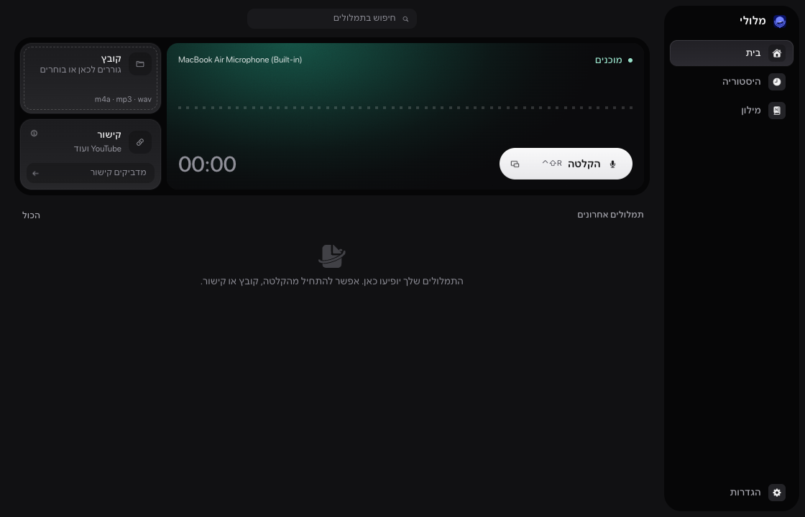

# Meluli · מלולי

Local Hebrew dictation for Apple Silicon Macs: press a shortcut, speak, then paste into the app you are using.

[עברית](README.md) · [Contributing](CONTRIBUTING.md) · [Security](SECURITY.md) · [MIT license](LICENSE)



**Status: Preview.** The source is open for reading and local builds. There is no Release yet, and packages are not Developer ID signed. An earlier intermittent paste failure was not reproduced and its cause is unknown; see [known limitations](docs/KNOWN-LIMITATIONS.md). [Build and install](docs/RELEASE.md).

## Features

- Microphone recording and a floating recorder with start, pause, resume, stop and cancel.
- In the floating recorder, `Esc` or Cancel discards audio; Stop transcribes and pastes.
- Default recording shortcut: `Control + Shift + R`; open the floating recorder: `Control + Shift + H`.
- Hold-to-talk, which also needs Input Monitoring.
- A personal dictionary alongside built-in English terms such as `CLAUDE.md`, and spoken punctuation such as "סימן שאלה" (question mark).
- An offer to transcribe Zoom, Google Meet and Teams calls on macOS 14.2 and later, off until you turn it on. Nothing records without a click, and you should record only calls you take part in.
- Ten themes, light and dark, plus following the system.
- Local Hebrew transcription and audio-file imports.
- Transcribe audio from links you are allowed to download, using an optional yt-dlp helper you build yourself (`pnpm run fetch:yt-dlp`).
- Searchable Hebrew history, text copying and SRT export when timed segments exist.
- Model prewarming at recording start, reuse between recordings and worker release after five idle minutes.

Microphone sessions are limited to 20 minutes each. Imported files do not share that duration cap. Supported imports are WAV, MP3, M4A, AIFF and CAF. The target platform is macOS on Apple Silicon; the build targets macOS 13.3+, while local validation has only covered M3 / 24 GB / macOS 27.0.1. The model is downloaded separately on first setup (approximately 874 MB).

## Privacy and storage

The product is designed for local transcription, with no cloud transcription or text processing. Downloads require network access for model setup and link imports. See [privacy](docs/PRIVACY.md).

The rename preserves the storage identity and existing history:

```text
~/Library/Application Support/IvritMenuBar/
```

This directory contains SQLite history, transcript text files and models. Before upgrading an existing history schema, the app saves a consistent SQLite snapshot under `backups/`. Meluli does not encrypt its history itself. A completed database result is retained if pasting or the optional TXT mirror fails.

## Development

Use Node.js 22.12 or newer, the pnpm version declared in `package.json`, Xcode Command Line Tools and CMake. Runtime preparation downloads pinned build tools into the project; installed-app users do not need their own Python or Node.

```bash
pnpm install --frozen-lockfile
pnpm run typecheck
pnpm run lint
pnpm test
pnpm run build:app
pnpm run test:e2e
```

Tests run using Electron's bundled Node to keep the native SQLite ABI consistent. E2E uses a fresh temporary profile. Never run automated tests against personal history.

To preview the UI without a model, set `MELULI_USER_DATA` to a new absolute directory and `IVRIT_E2E_MOCK=1`. This mode simulates audio, transcription and pasting. It does not exercise physical microphone capture or ASR accuracy. For normal development, run `pnpm dev` after preparing the transcription worker. Run `pnpm run prepare:runtime` for all bundled helpers, `pnpm run build:asr-worker` for ASR only, or `pnpm build` for arm64 DMG and ZIP. Model setup verifies an immutable revision and SHA-256. See [benchmark evidence and limitations](docs/BENCHMARKS.md).

## Structure and licensing

`src/main` holds Electron services and SQLite; `src/preload` exposes a limited typed API; `src/renderer` holds React views; `src/shared` holds contracts and schemas. See [architecture](docs/ARCHITECTURE.md) and [testing](docs/TESTING.md).

Application code is MIT licensed. Meluli's name, logo and app icon are not covered by that license, so a fork needs its own: see [TRADEMARKS.md](TRADEMARKS.md). Models, symbols and third-party tools retain their own terms; full attributions are in [THIRD_PARTY_NOTICES.md](THIRD_PARTY_NOTICES.md).

Meluli is an independent project. It is not affiliated with, sponsored by or endorsed by Apple, Zoom, Google, Microsoft, OpenAI, ivrit.ai or any other company named here. Those names belong to their owners and are used only to describe compatibility.
