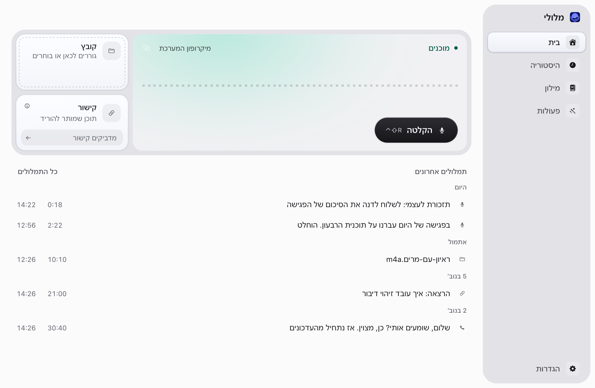
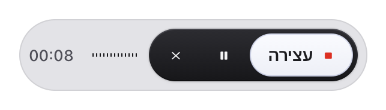

# מלולי · Meluli

הכתבה בעברית על ה־Mac: קיצור מקלדת, דיבור, והטקסט מודבק במקום שבו עובדים. התמלול רץ במחשב, בלי ענן.

[English](README.en.md) · [פיתוח ותרומה](CONTRIBUTING.md) · [אבטחה](SECURITY.md) · [רישיון MIT](LICENSE)

<picture>
  <source media="(prefers-color-scheme: dark)" srcset="docs/images/home-dark.png">
  
</picture>

## התקנה

מלולי 2.0 (גרסה 0.2.0) היא אפליקציה מקורית ל־macOS, חתומה ב־Developer ID ומאושרת (notarized) על ידי Apple. מורידים את קובץ ה־DMG מעמוד ה־[Releases](https://github.com/rashi123123/meluli/releases/latest), או מתקינים עם Homebrew:

```bash
brew install --cask rashi123123/meluli/meluli
```

נדרש Mac עם Apple Silicon ו־macOS 13.3 ומעלה. מודל העברית יורד בהפעלה הראשונה (874MB בקירוב), ומאז התמלול עובד גם בלי אינטרנט. מי שהתקין גרסת Preview קודמת צריך להתקין את 2.0 ידנית פעם אחת; ההיסטוריה וההגדרות נשמרות. לפני ההתקנה כדאי לעבור על [המגבלות הידועות](docs/KNOWN-LIMITATIONS.md).

## איך זה עובד

1. **לוחצים על הקיצור** (`Control + Shift + R`) או מחזיקים את מקש ההכתבה, בכל אפליקציה.
2. **מדברים.** חלון צף קטן מראה שההקלטה פועלת, ואפשר להשהות, להמשיך או לבטל.

   <picture>
     <source media="(prefers-color-scheme: dark)" srcset="docs/images/hud-dark.png">
     
   </picture>

3. **עוצרים.** מנוע Whisper בעברית מתמלל במחשב, המילון האישי וכללי הכתיבה מסדרים את הטקסט, והוא מודבק בשדה שבו הייתם. אם ההדבקה לא הצליחה, הטקסט נשאר בבית ובהיסטוריה, ואף פעם לא מודבק פעמיים.

מאחורי הקלעים: מארח Swift קטן מריץ את שירותי האפליקציה ב־JavaScriptCore של macOS, והחלון נפתח ב־WebKit רק כשצריך אותו. כשהחלון סגור מלולי תופסת כ־59MB בזיכרון. פרטים: [ארכיטקטורה](docs/ARCHITECTURE.md).

## מה יש בה

- הקלטה בקיצור או בהחזקת מקש (Hold-to-talk), עם חלון צף להשהיה, המשך, עצירה וביטול. `Esc` מבטל, ואפשר לשחזר הקלטה שבוטלה בטעות.
- טקסט שנכתב כמו שכותבים: מספרים בספרות, סימן שאלה לשאלות, נקודה בהפסקה ברורה, כתובות מייל ואתרים ומספרי טלפון בצורתם הרגילה, ותיקונים בדיבור ("בשלוש, סליחה, בארבע").
- עברית ואנגלית באותה שורה נשארות בסדר הנכון בהדבקה.
- מילון אישי וחבילות מונחים מובנות (AI, פיתוח, כלי עבודה, מוצר, עיצוב ושיווק) שאפשר להדליק ולכבות.
- פעולות: שרשרת של צעדי מודל שפה שרצה על ההכתבה לפני ההדבקה, למשל מייל מנוסח או פרומפט באנגלית. מביאים מפתח משלכם (OpenAI, ‏Anthropic, ‏OpenRouter, ‏Gemini, ‏Groq או כתובת תואמת OpenAI) או מריצים Ollama במחשב.
- היסטוריה עם חיפוש בעברית, נגינת ההקלטה מכל משפט, עריכה, וייצוא ל־Markdown, ‏WebVTT ו־SRT.
- ההקלטות נשמרות שבוע ואפשר לתמלל אותן מחדש, והקלטה שהתמלול שלה נכשל לא הולכת לאיבוד.
- ייבוא קובצי שמע (WAV, ‏MP3, ‏M4A, ‏AIFF, ‏CAF), ותמלול מקישורים שמותר לכם להוריד דרך רכיב yt-dlp אופציונלי שנבנה אצלכם.
- הצעה לתמלל שיחות Zoom, ‏Google Meet ו־Teams ב־macOS 14.2 ומעלה, כבויה עד שמפעילים אותה. שום דבר לא מוקלט בלי לחיצה.
- מנוע זורם ניסיוני, "מהיר וקל", שמציג את הטקסט תוך כדי דיבור ומוכן מיד בסוף. הוא פחות מדויק מ־Whisper, שנשאר ברירת המחדל. [מדידות](docs/BENCHMARKS.md#streaming-engine--7-november-2026).
- עשר ערכות נושא, בהירות וכהות, ומעקב אחרי מצב המערכת.

הקלטת מיקרופון מוגבלת ל־20 דקות. קבצים מיובאים אינם כפופים למגבלה הזאת. הבדיקות נערכו על M3 עם 24GB ב־macOS 27.0.1.

## פרטיות ונתונים

התמלול מקומי בלבד. אין אנליטיקה ואין טלמטריה. טקסט נשלח למודל שפה רק דרך פעולה שהגדרתם, ורק לכתובת שאישרתם; פעולה עם Ollama נשארת במחשב. האינטרנט משמש גם להורדת המודל, לבדיקת עדכונים (אפשר לכבות) ולייבוא מקישורים. פרטים: [פרטיות](docs/PRIVACY.md).

הנתונים נשמרים בתיקייה:

```text
~/Library/Application Support/IvritMenuBar/
```

היא מכילה את מסד SQLite, קובצי הטקסט, ההקלטות והמודל. לפני שדרוג של מבנה המסד נשמר גיבוי בתיקיית `backups/`. מלולי אינה מצפינה את ההיסטוריה בעצמה. תוצאת תמלול נשמרת במסד גם אם ההדבקה נכשלת.

## פיתוח

נדרשים Node.js 22.12 ומעלה, pnpm בגרסה שמוצהרת ב־`package.json`, כלי הפיתוח של macOS (Xcode Command Line Tools) ו־CMake.

```bash
pnpm install --frozen-lockfile
pnpm run prepare:runtime
pnpm run typecheck
pnpm run lint
pnpm test
```

`pnpm dev` מריץ את אותו קוד בסביבת פיתוח מבוססת Electron. `pnpm lab` פותח את כל רכיבי הממשק ומצביהם בדפדפן, בלי מודל ובלי הרשאות. `node scripts/meluli2/build-native-app.mjs` בונה את האפליקציה המקורית לבדיקה, עם מזהה, פרופיל ופריט Keychain נפרדים, כך שהיא לא נוגעת בהיסטוריה האישית. גרסאות חתומות נבנות רק ב־[תהליך השחרור](docs/RELEASE.md).

## מבנה ותרומה

`native/host` הוא מארח ה־Swift; `src/native-host` מממש מעליו את החלק של Node ו־Electron שהשירותים צריכים; `src/main` מכיל את השירותים והמסד; `src/preload` מגדיר API מוגבל ומוקלד; `src/renderer` מכיל את ממשק React; `src/shared` מכיל חוזים וסכימות. [ארכיטקטורה](docs/ARCHITECTURE.md) · [החלטות](docs/DECISIONS.md) · [בדיקות](docs/TESTING.md) · [מדידות](docs/BENCHMARKS.md).

שאלות ורעיונות ב־[Discussions](https://github.com/rashi123123/meluli/discussions), באגים ב־[Issues](https://github.com/rashi123123/meluli/issues). לפני תרומה: [CONTRIBUTING.md](CONTRIBUTING.md) ו־[קוד ההתנהגות](CODE_OF_CONDUCT.md).

קוד האפליקציה מופץ ברישיון MIT. השם, הלוגו והאייקון של מלולי אינם כלולים בו, ו־fork צריך שם ואייקון משלו: ראו [TRADEMARKS.md](TRADEMARKS.md). מודלים, סמלים וכלים חיצוניים שומרים על התנאים שלהם; הרישיונות והייחוסים מפורטים ב־[THIRD_PARTY_NOTICES.md](THIRD_PARTY_NOTICES.md).

מלולי היא פרויקט עצמאי, ואין לה קשר, חסות או אישור מצד Apple, ‏Zoom, ‏Google, ‏Microsoft, ‏OpenAI, ‏Anthropic, ‏ivrit.ai או כל חברה אחרת שמוזכרת כאן. השמות שייכים לבעליהם ומשמשים רק לתיאור תאימות.
