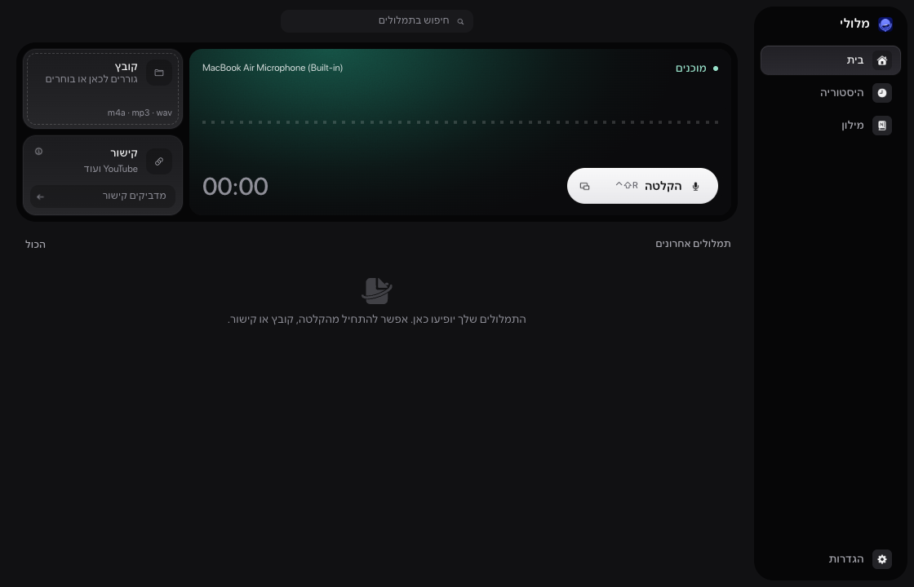

# מלולי · Meluli

הכתבה בעברית על ה־Mac: קיצור מקלדת, דיבור והדבקת הטקסט במקום שבו עובדים.

[English](README.en.md) · [פיתוח ותרומה](CONTRIBUTING.md) · [אבטחה](SECURITY.md) · [רישיון MIT](LICENSE)



**מצב הפרויקט: Preview.** הקוד פתוח לעיון ולבנייה מקומית. אין עדיין Release, והחבילות אינן חתומות ב־Developer ID. כשל הדבקה ישן לא שוחזר וסיבתו אינה ידועה; ראו [מגבלות ידועות](docs/KNOWN-LIMITATIONS.md). [בנייה והתקנה](docs/RELEASE.md).

## מה האפליקציה עושה

- הקלטת מיקרופון וחלון צף עם התחלה, השהיה, המשך, עצירה וביטול.
- בחלון הצף, `Esc` או כפתור הביטול משליכים את ההקלטה; כפתור העצירה מתמלל ומדביק.
- קיצור ברירת מחדל להקלטה: `Control + Shift + R`; לפתיחת החלון הצף: `Control + Shift + H`.
- הקלטה בהחזקת מקש (Hold-to-talk), שדורשת גם הרשאת ניטור קלט.
- מילון אישי לצד מונחים מובנים באנגלית, כמו `CLAUDE.md`, וסימני פיסוק מוכתבים, כמו "סימן שאלה".
- הצעה לתמלל שיחות Zoom, ‏Google Meet ו־Teams ב־macOS 14.2 ומעלה, כבויה עד שמפעילים אותה. שום דבר לא מוקלט בלי לחיצה, ומקליטים רק שיחות שמשתתפים בהן.
- עשר ערכות נושא, בהירות וכהות, וגם מעקב אחרי מצב המערכת.
- תמלול מקומי בעברית וייבוא קובצי שמע.
- תמלול שמע מקישורים שמותר לכם להוריד, דרך רכיב yt-dlp אופציונלי שנבנה אצלכם (`pnpm run fetch:yt-dlp`).
- היסטוריה עם חיפוש בעברית, העתקת טקסט וייצוא SRT כאשר קיימים מקטעי זמן.
- טעינת מודל בתחילת ההקלטה ושחרור העובד אחרי חמש דקות ללא שימוש.

הפרויקט מיועד ל־Mac עם Apple Silicon. יעד הבנייה הוא macOS 13.3 ומעלה; הבדיקות המקומיות נערכו רק על M3 עם 24GB ב־macOS 27.0.1. המודל יורד בנפרד בהפעלה הראשונה (874MB בקירוב). הקלטת מיקרופון מוגבלת ל־20 דקות בכל מחזור. קבצים מיובאים אינם כפופים למגבלה הזאת. קובצי הייבוא הנתמכים: WAV, MP3, M4A, AIFF ו־CAF.

## פרטיות ונתונים

תכנון האפליקציה הוא תמלול מקומי בלבד, ללא שירות ענן לתמלול או לעיבוד הטקסט. חיבור לרשת נדרש להורדת מודל ולייבוא מקישורים. פרטים: [פרטיות](docs/PRIVACY.md).

שינוי השם אינו מעביר או מוחק את ההיסטוריה. תיקיית הנתונים נשארת:

```text
~/Library/Application Support/IvritMenuBar/
```

היא מכילה את מסד SQLite, קובצי הטקסט והמודל. לפני שדרוג סכימת היסטוריה קיימת נשמר גיבוי SQLite בתיקיית `backups/`. האפליקציה אינה מצפינה את ההיסטוריה בעצמה. תוצאת תמלול נשמרת במסד גם אם ההדבקה או כתיבת עותק ה־TXT נכשלות.

## פיתוח

נדרשים Node.js 22.12 ומעלה, pnpm בגרסה המוצהרת ב־`package.json`, כלי הפיתוח של macOS (Xcode Command Line Tools) ו־CMake. תהליך ההכנה מוריד כלי בנייה מוצמדים לתיקייה מקומית בפרויקט; משתמשי החבילה אינם צריכים Node או Python מותקנים.

```bash
pnpm install --frozen-lockfile
pnpm run typecheck
pnpm run lint
pnpm test
pnpm run build:app
pnpm run test:e2e
```

הבדיקות משתמשות בגרסת Node הכלולה ב־Electron, כדי לשמור התאמה למודול SQLite המקומי. בדיקות E2E יוצרות פרופיל זמני ונפרד. אין להריץ בדיקות מול ההיסטוריה האישית.

לצפייה בממשק ללא הורדת מודל, הגדירו תיקייה חדשה ומוחלטת ב־`MELULI_USER_DATA` והפעילו עם `IVRIT_E2E_MOCK=1`. מצב זה מדמה גם הקלטה, תמלול והדבקה; הוא אינו בודק את המיקרופון או את איכות המנוע. להפעלה רגילה: `pnpm dev` לאחר הכנת עובד התמלול. הכנת הרכיבים: `pnpm run prepare:runtime`. יצירת DMG ו־ZIP: `pnpm build`. בניית התמלול בלבד: `pnpm run build:asr-worker`. ההורדה באפליקציה מאמתת SHA-256 ורוויזיה מוצמדת. [תוצאות ההשוואה והמגבלות](docs/BENCHMARKS.md).

## מבנה ותרומה

`src/main` מכיל את שירותי Electron והמסד; `src/preload` מגדיר API מוגבל ומוקלד; `src/renderer` מכיל את ממשק React; `src/shared` מכיל חוזים וסכימות. [ארכיטקטורה](docs/ARCHITECTURE.md) · [בדיקות](docs/TESTING.md).

קוד האפליקציה מופץ ברישיון MIT. השם, הלוגו והאייקון של מלולי אינם כלולים בו, ו־fork צריך שם ואייקון משלו: ראו [TRADEMARKS.md](TRADEMARKS.md). מודלים, סמלים וכלים חיצוניים שומרים על התנאים שלהם; הרישיונות והייחוסים מפורטים ב־[THIRD_PARTY_NOTICES.md](THIRD_PARTY_NOTICES.md).

מלולי היא פרויקט עצמאי, ואין לה קשר, חסות או אישור מצד Apple, Zoom, Google, Microsoft, OpenAI, ivrit.ai או כל חברה אחרת שמוזכרת כאן. השמות שייכים לבעליהם ומשמשים רק לתיאור תאימות.
